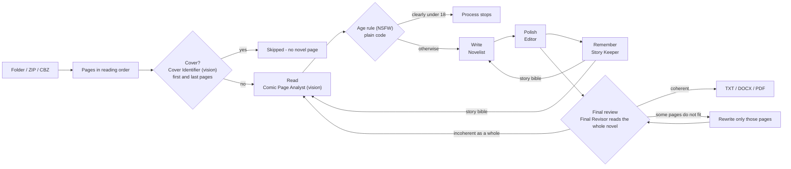

# CTS - Comic To Story

**CTS turns comic volumes into novels.** Drop a folder or ZIP of comic pages, and a team of AI agents reads every page, writes it as prose, edits it, and keeps the story consistent from the first page to the last - producing a complete novel in either an **SFW** or an **NSFW** edition.

- **One comic page = one novel page.** Pacing, order and dialogue stay faithful to the original. Book covers are recognised and **skipped** - a cover is packaging, not story.
- **Multi-step agents** built with [CrewAI](https://github.com/crewAIInc/crewAI): *Read → Write → Polish → Remember* for every page, then a **Final Revisor** that reads the whole novel as a book before you get it: coherent -> it passes; otherwise the pages that do not fit - or the whole volume - are written again.
- **Your own system prompt (optional)** to steer the narrative - voice, tone, style, point of view - in both the SFW and the NSFW edition.
- **Bring your own AI:** frontier models (Claude, ChatGPT, Grok, Gemini, OpenRouter, any OpenAI-compatible endpoint) **or** local GGUF models from Hugging Face, with the quantization of your choice.
- **Batch mode:** attach several volumes and CTS writes them one after another (volume 1, then 2, then 3...), carrying names and plot between volumes.
- **Export** the finished novel as **TXT, DOCX or PDF** (6 x 9 in pages, one novel page per comic page).
- **A clean, dark web UI** (plain HTML, CSS and JavaScript - no build step) that runs locally on your computer.
- **Private by default:** everything runs on your machine; CrewAI telemetry is switched off. Comic pages only leave your computer if *you* pick a hosted AI provider.

> **Status: v0.4 (early release).** The pipeline, UI and Linux installer have been exercised end to end, and the llama.cpp installer and the connection to the local engine are covered by tests that simulate GitHub releases and a llama-server. The Windows and macOS installers follow the same design but have not been verified on real machines yet - please [open an issue](https://github.com/KMC1525/CTS/issues) if anything misbehaves. See the [changelog](CHANGELOG.md) for what is new.

---

## Install

CTS runs on **Windows, macOS and Linux**. The installer sets everything up for you: a private Python environment, CTS and all of its libraries (CrewAI, FastAPI, Pillow, python-docx, ReportLab...), the llama.cpp engine for local models, and an entry in your **applications list** (Start Menu / Launchpad / app menu). You do not need to install Python yourself.

### macOS and Linux

```bash
curl -fsSL https://raw.githubusercontent.com/KMC1525/CTS/main/install.sh | bash
```

### Windows (PowerShell)

```powershell
irm https://raw.githubusercontent.com/KMC1525/CTS/main/install.ps1 | iex
```

When it finishes, open **CTS** from your applications list, or run `cts` in a terminal. It starts a small local server and opens the app in your browser.

<details>
<summary>What the installer does, and options</summary>

1. Installs [`uv`](https://docs.astral.sh/uv/) if it is missing (it can fetch the right Python for you).
2. Creates a private Python 3.12 environment (`~/.cts` on macOS/Linux, `%LOCALAPPDATA%\Programs\CTS` on Windows).
3. Installs CTS and **every** dependency into it (CrewAI with its Anthropic and Gemini clients, FastAPI, Pillow, python-docx, ReportLab...).
4. Installs the prebuilt [llama.cpp](https://github.com/ggml-org/llama.cpp) engine used for local models, **runs it to check that it starts**, and installs the system libraries it needs when it can (see [llama.cpp engine](#the-llamacpp-engine)). If this step fails, the rest of CTS is still installed and you can retry later.
5. Runs `cts doctor --fix`, which checks every library and repairs what is missing.
6. Adds CTS to your applications list and puts a `cts` command on your `PATH`.

Options when you run the script from a checkout: `--no-runtime`, `--no-desktop`, `--dev` (editable install), `--uninstall`, `--purge` (Windows: `-NoRuntime`, `-NoDesktop`, `-Dev`, `-Uninstall`, `-Purge`). Set `CTS_REF` to install a different branch or tag.

If `uv` cannot be installed, the scripts fall back to a system Python 3.10-3.13.

**Uninstall:** `./install.sh --uninstall` (add `--purge` to also delete your settings, models and novels), or on Windows `.\install.ps1 -Uninstall`.

</details>

### Updating

Run the same install command again, or run `cts update`. An update **reinstalls CTS from the latest code, upgrades every Python library, updates llama.cpp to its newest release (and re-checks its system libraries), and refreshes your applications-menu entry.** Your settings, models, uploaded volumes and generated novels are kept. To update only the llama.cpp engine, use `cts setup-runtime --update` or the **Update** button in *Settings → Local models*.

---

## Quick start

1. **Choose an AI** - click **Settings** (bottom-left).
   - *Frontier AI:* pick a provider, paste your API key, choose a vision-capable model.
   - *Local models (GGUF):* pick a model, press **Show quantizations**, choose one, and **Install**.
2. **Attach your comic** - drag a folder or ZIP/CBZ onto the **zip box** on the left (or use the *ZIP / CBZ* and *Folder* buttons). Add as many volumes as you like.
3. **Pick the options** - SFW or NSFW edition, words per page, novel language, whether to skip covers, whether to run the final review, and (optionally) your own **system prompt** to direct the narrative.
4. **Press Generate.** Watch the **story box** on the right: every page shows its progress through *Read → Write → Polish → Remember*, and the novel text appears as it is written. When all pages are written the **final review** runs; the *Review* button shows its report.
5. **Download** the volume as **TXT**, **DOCX** or **PDF** when it is ready. You can stop at any time and download what exists so far, or resume later.

---

## How it works



For **every page**, CTS runs small CrewAI crews (the first step only on the first and last pages of a volume):

| Step | Agent | What it does |
| --- | --- | --- |
| **Cover?** | Cover Identifier | Looks at the first two and last two pages of each volume and decides whether one is a book cover (front, back, spine, jacket) - see [Covers](#covers). |
| **Read** | Comic Page Analyst | Looks at the page image: reading order (including right-to-left manga), every panel, all dialogue and captions verbatim, characters and the ages the comic states, mood - plus safety flags. |
| **Write** | Novelist | Writes exactly one page of prose from the analysis, the **story bible** and the most recent novel pages. |
| **Polish** | Editor | Checks fidelity against the analysis, continuity, style and the word budget. Over-long pages are condensed. |
| **Final review** | Final Revisor | After the last page, reads the finished novel as a book and judges its coherence - see [Final review](#final-review). |
| **Remember** | Story Keeper | Updates the **story bible** (voice, characters, places, plot so far, open threads) so the next page - and the next volume - stays consistent. |

Progress is saved page by page, so an interrupted job can be **resumed** without repeating finished pages.

### Final review

Before a volume is delivered, the **Final Revisor** (prompt: [`final-revisor.md`](cts/prompts/final-revisor.md)) reads all the written pages **as a book** - the pages are checked one by one while they are written, but only a whole-book read can catch a coat that changes colour on page 40, a narrator who slips from third person to first, or a page that restarts the scene. It never rewrites anything itself; it only judges:

1. **Windows.** The novel is read in windows of consecutive pages that fit your model's context window, together with the story bible. For every page the revisor writes a one-line summary and, if something is wrong, the concrete problem ("the bible says her coat is red").
2. **Mechanical checks (no model needed).** Empty pages, placeholders for pages that failed, refusals, leaked instructions and a page that repeats the previous one are found by plain code. These pages are *always* written again, even if the revisor says the rest is fine.
3. **Verdict.** From the bible, the one-line summaries and the problems found, the revisor decides:
   - **`coherent`** -> the novel **passes** and is delivered as it is;
   - **`fix-pages`** -> only the pages it names are written again, with its notes and the faulty version in front of the writer. The saved page analysis is reused, so **the comic image is not read again**, and every other page is kept exactly as it was. Only the rewritten pages (and their neighbours) are reviewed again;
   - **`redo-all`** -> the book is incoherent as a whole (for example the voice or the names are inconsistent on most pages) and the **entire volume is produced again** - images included - guided by the revisor's notes.
4. **A limit, so it cannot loop.** At most **two rewrites** are made per volume (a rewrite is either some pages or the whole volume). If problems remain after that, the novel is delivered anyway and the report says what is left (*Review: open issues*). If the review cannot run (for example the provider fails), the novel is delivered without it.

The report of every round - verdict, reason, pages rewritten, the problems found - is in the **Review** button of the story box and is saved with the job. A volume that was already reviewed is not reviewed again when you resume, unless its text changed. Turn the review off with *Final review before delivery* under the novel options; it costs one model call per window of pages plus one for the verdict (a few calls for a typical volume), and more only when pages are rewritten.

### System prompt (optional)

Under the novel options, **System prompt (optional)** is a text box (up to 6,000 characters) where you can write your own direction for the narrative - for example *"Write in a hard-boiled noir voice: first person, present tense, short cynical sentences"*, *"Make it a gothic ghost story with long, slow sentences"*, or *"Keep the narrator warm and a little funny"*. It is remembered between sessions.

- It applies to the **SFW and the NSFW edition** alike, on every page, and is also given to the story keeper (so the voice it records matches) and to the final revisor (so the style you asked for is not reported as a defect).
- It steers **voice, tone, style, point of view, tense, vocabulary and emphasis**. It does **not** change what happens on each comic page, the one-page-per-page contract, the rating policy of the edition or the **age rule** - those always win. The age rule is enforced by code on the page analysis, so no system prompt can switch it off.
- It is placed after the built-in novelist prompt and *before* the rating policy, so the rating rules remain the last thing the model reads.

### Context window

*Settings → Context window* tells CTS how much text your model can hold. CTS uses it to decide how much story-so-far (bible + recent pages) it feeds to each page. For local models it is also passed to llama.cpp, so bigger windows need more RAM/VRAM.

| Window | Notes |
| --- | --- |
| 8K | The minimum CTS accepts (a page image, the prompts and the answer must fit). Little memory of previous pages. |
| 16K-32K | Good default for local models and most pages. |
| 64K+ | Best continuity; use with hosted models or lots of memory. |

### SFW and NSFW editions

- **SFW** keeps romance and tension but closes the door on sexual scenes and avoids gratuitous gore.
- **NSFW** is an adults-only edition: where the comic shows or implies sexual content between **adult** characters, it is written fully.
- **Age rule (NSFW edition) - the comic decides.** A character's age is taken from what the comic itself says, never from drawing style:
  - the comic makes it **clear that a character is under 18** (an age below 18 in dialogue, a caption or a document; the story calling them a child, kid, minor or teenager; a school grade below university with no statement that they are 18+; or someone who is unmistakably a young child) -> **the whole process stops.** Nothing is written for that page, the pages before it are kept as a partial novel, and the message tells you which character and why. Generate the SFW edition instead;
  - the comic makes it clear that the character is **18 or older** -> generation continues;
  - the comic **does not mention ages** -> everyone is treated as an adult and generation continues.

  The check has two layers: the analyst reports each character's *stated* age and a `minor_involved` flag, and plain code (not a prompt a model could talk its way around) stops the process on a stated age below 18 or on that flag; the NSFW prompt also tells the writing model to stop with a `[[CTS-STOP-MINOR]]` answer if it meets such a character. A character established as a minor on one page stays a minor on later pages. The SFW edition does not apply this rule. It relies on the model's reading of the page, so no automated check is perfect: review your output.
- If the analyst does not return its safety flags for a page that may be sexual, the page is written in SFW terms instead of guessing.
- Hosted providers may **decline** NSFW pages. CTS detects a refusal, falls back to the SFW version of that page, and tells you. **Local models are the most reliable choice for the NSFW edition.**

### Input

- One folder or ZIP/CBZ = **one volume**. Images: JPG, PNG, WebP, BMP, GIF, TIFF. Pages are ordered naturally (`2.jpg` before `10.jpg`).
- If a folder/ZIP contains several sub-folders named like volumes (`Vol 1`, `Volume 02`, `v3`, `Tome 4`...) and no pages of its own, each sub-folder becomes its own volume.
- Volumes are generated in the order shown in the zip box - use the arrows to reorder.

### Covers

The `cover-identify` prompt (see [`cts/prompts/`](cts/prompts)) checks the **first two and last two pages** of every volume with one short vision call each and decides whether the page is a book cover: front, back, spine, flap or wrap-around, recognised by title lettering, publisher or imprint, barcode, blurb and the absence of panels. **A cover is skipped: no analysis, no novel page.** The check is deliberately conservative (it must be at least medium-confident, and a real story page is never dropped on a guess); chapter title pages, splash pages and advertisements are not covers. If the title is printed on a front cover, it becomes the title of the exported novel. Turn it off with *Skip book covers* under the novel options.

### Output

Each volume produces a `TXT`, `DOCX` and `PDF`: a title page, then one novel page per story page of the comic (covers are left out and the novel pages are numbered 1, 2, 3...) on 6 x 9 in pages (long pages shrink slightly to stay on one page). Files live in your CTS data folder (`cts info` shows where) and are also available from the download buttons.

---

## AI providers

### Frontier (hosted) models

| Provider | Notes |
| --- | --- |
| Anthropic Claude | Native client. |
| OpenAI ChatGPT | Native client. |
| xAI Grok | OpenAI-compatible endpoint (`https://api.x.ai/v1`). |
| Google Gemini | Native client. |
| OpenRouter | One key, many models - use a vision-capable model. |
| Custom endpoint | Any OpenAI-compatible server (LM Studio, vLLM, Ollama `/v1`, a gateway...). |

The model **must accept images**. The model name box accepts any model id, so new models work as soon as your provider offers them. API keys are stored only in your local `settings.json` (owner-readable), and are never sent back to the browser. As a fallback CTS reads the usual environment variables (`ANTHROPIC_API_KEY`, `OPENAI_API_KEY`, `XAI_API_KEY`, `GEMINI_API_KEY`, `OPENROUTER_API_KEY`).

> Hosted AI usage is billed by your provider. A page costs roughly four model calls (one with an image), so a 200-page volume is on the order of 800 calls, plus a few dozen for the final review (more if pages must be rewritten) - check your provider's pricing first.

### Local models (GGUF via Hugging Face)

CTS runs local models with [llama.cpp](https://github.com/ggml-org/llama.cpp)'s `llama-server`. In *Settings → Local models*:

1. Make sure the engine is ready - the installer normally did this; otherwise press **Install llama.cpp** (see [below](#the-llamacpp-engine)).
2. Choose a curated vision model, or **Other Hugging Face repository...** to search or paste any `owner/model-GGUF` repo.
3. Press **Show quantizations** and pick one. Smaller (`Q4_K_M`, `IQ4_XS`...) is faster and lighter; larger (`Q6_K`, `Q8_0`) is closer to the original quality. Sizes are shown before you download.
4. Press **Install**. The model and its vision projector (`mmproj`) are downloaded with progress, and the download resumes if interrupted.

The model must be **vision-capable** (a repository that ships an `mmproj` file) or it cannot read comic pages. Gated models need a Hugging Face token (*Settings → Local models*).

### How CTS talks to the local engine

Most problems with local models happen between the app and the engine, so CTS checks and handles these for you:

- **Files first:** the model and its vision projector must exist and be real GGUF files (a failed download is often an HTML error page).
- **Sized to your machine:** on current llama.cpp builds CTS lets the engine fit the model into the memory you have (`--fit`) instead of forcing every layer onto the GPU, and turns off "thinking" (`--reasoning off`) so a reasoning model cannot spend the whole answer on hidden thoughts and return an empty page. Flags an older build does not know are never passed.
- **Verified after start:** CTS asks the running server (`/props`) whether vision really loaded and how much context it really has, and plans with that number - not with what you asked for.
- **Never through a proxy:** traffic to `127.0.0.1` ignores `HTTP_PROXY` / `ALL_PROXY` (and `NO_PROXY` is extended), so a company proxy cannot break the connection.
- **Self-healing:** if the engine dies in the middle of a generation (out of memory, killed), CTS restarts it and retries the page. **Stop** also stops the engine at once so a long generation does not keep running; **Quit** and deleting a model no longer wait for a model that is still loading; and an engine left behind by a crashed CTS is cleaned up on the next start.
- **Clear errors:** a request that does not fit the context window, or a model that cannot read images, is reported with what to change instead of being retried.
- **Checked before queueing:** a job is refused up front, with a message, if the engine is not installed, the model files are missing or the context window is below 8K.

### The llama.cpp engine

CTS downloads the official prebuilt llama.cpp for your system and manages it for you:

- **Picks the right build.** macOS: the native build (Metal GPU support is included). Windows and Linux: the **Vulkan** build (works with NVIDIA, AMD and Intel GPUs without extra toolkits), with the plain **CPU** build as an automatic fallback.
- **Checks that it works.** The engine is run (`llama-server --version`) before CTS accepts it. If a GPU build does not start on your machine, CTS installs the CPU build instead.
- **Installs missing system libraries.** On Linux it detects a missing `libgomp` / `libvulkan` and installs it with your package manager when it can (as root, or with passwordless `sudo`); otherwise it prints the exact command to run. On Windows it installs the Microsoft Visual C++ Redistributable with `winget` when the engine reports a missing DLL.
- **Updates.** *Settings → Local models → Update* (or `cts setup-runtime --update`) moves to the newest llama.cpp release; new model families often need a newer engine.
- **Works around GitHub limits.** llama.cpp publishes its builds as pre-releases (tags `b12111`...), so CTS lists the releases and picks the newest build tag itself. If the GitHub API is rate-limited or blocked, it reads the public releases feed instead; if the newest build's files are not uploaded yet, it uses the previous build. Set `GITHUB_TOKEN` to raise the API limit.
- **Installs safely.** The engine is unpacked into a temporary folder and only moved into place once it works, so a failed install never leaves a broken engine behind.
- **Respects yours.** If `llama-server` is already on your `PATH` (for example from `brew` or `winget`) or set with `CTS_LLAMA_SERVER`, CTS uses it and never replaces it.

**Troubleshooting:** run `cts doctor` (add `--fix` to repair). In *Settings → Local models*, **Check** runs the engine and shows the exact error, and **Repair** reinstalls it. To force a build, run `cts setup-runtime --repair --flavor cpu` (or `vulkan`, `cuda`...); `cuda` builds also download the matching CUDA runtime archive. To use your own build, set `CTS_LLAMA_SERVER` to the `llama-server` binary.

---

## Customising the prompts

The quality of the novels and of the page analysis is driven by Markdown system prompts shipped in [`cts/prompts/`](cts/prompts). Copy any of them to your CTS data folder under `prompts/` (run `cts info` for the exact path) and edit it there - your copy wins over the built-in one and survives upgrades. See [`cts/prompts/README.md`](cts/prompts/README.md).

## Command line

| Command | What it does |
| --- | --- |
| `cts` / `cts launch` | Start CTS in the background (if needed) and open it in the browser. |
| `cts serve` | Run the server in this terminal (`--port`, `--no-browser`). |
| `cts stop` | Stop the background server. |
| `cts update` | Update CTS, all its Python libraries and llama.cpp (re-runs the installer). |
| `cts doctor` | Check every library CTS needs, including llama.cpp and its system libraries. `--fix` repairs what is missing. |
| `cts setup-runtime` | Install the llama.cpp engine. `--update` moves to the newest release, `--repair` reinstalls it, `--flavor cpu\|vulkan\|cuda` forces a build. |
| `cts install-desktop` / `cts uninstall-desktop` | Add/remove CTS in your applications list. |
| `cts info` | Show the data folder, custom-prompt folder and engine status. |
| `cts purge --yes` | Delete all CTS data (settings, models, uploads, novels). |

## Privacy and security

- The server listens on `127.0.0.1` only and rejects requests from other websites (Host and Origin checks).
- CrewAI telemetry and tracing are disabled.
- Uploads, models and novels stay in your data folder. Frontier providers receive page images and text only when you select them.

## Development

```bash
git clone https://github.com/KMC1525/CTS.git && cd CTS
./install.sh --dev --no-runtime --no-desktop            # editable install into ~/.cts
uv pip install --python ~/.cts/venv/bin/python -e ".[dev]"   # adds pytest
~/.cts/venv/bin/python -m pytest
~/.cts/venv/bin/cts serve
```

Layout: `cts/pipeline/` (CrewAI agents and runner), `cts/prompts/` (system prompts), `cts/local/` (Hugging Face and llama.cpp), `cts/web/` (the vanilla front end), `cts/server.py` (API), `cts/export.py` (TXT/DOCX/PDF), `install.sh` / `install.ps1`.

The tests run the whole pipeline through real CrewAI against a local mock of the OpenAI API, so they need no keys and no network.

## Responsible use

CTS adapts comics into prose with generative AI. Only use material you have the right to use, and respect the copyright of the comics you convert. The NSFW edition is for adults; you are responsible for the content you generate and share. AI output can contain mistakes - read it before you publish it.

## License

[MIT](LICENSE) - Copyright (c) 2026 KMC
